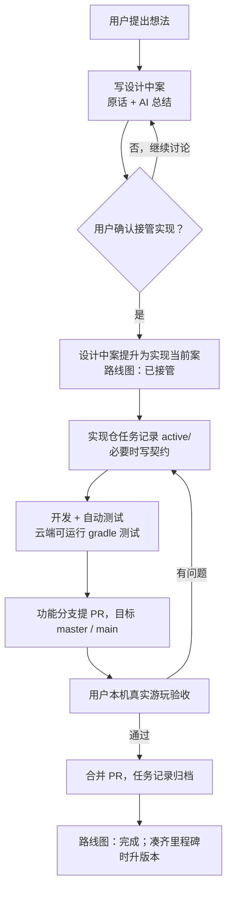

# 开发流程

从一个想法到进入游戏的完整链路。各步骤的细则在对应工作流和规范里，本页只串联顺序；状态统一记录在[路线图](路线图.md)。

| 步骤 | 依据 |
| --- | --- |
| 写案与身份 | [需求案规则](../01_workflows/需求案规则.md) |
| 任务记录与 Bug | [开发与 Bug 留档规则](../01_workflows/开发与Bug留档规则.md) |
| 真实游玩验收 | [真实游玩 Agent Loop 规则](../01_workflows/真实游玩AgentLoop规则.md) |
| 提交、分支与 PR | [Git 提交规则](../02_standards/Git提交规则.md) |
| 版本号 | [版本规则](../02_standards/版本规则.md) |

## 分支

- 主线分支：实现仓 `master`、文档仓 `main`，始终代表最新的已合并状态。
- 2026-10-14 用户决定保留 `master` / `main`：9 月 22 日重新导入时另起的 `codex/offline-structure-studio` 已通过“保留当前内容”的历史合并接回原主分支，原有提交全部保留。合并完成后主分支快进到最新状态，此后不再使用 `codex/offline-structure-studio`。
- 每项工作在独立的功能分支上进行，完成后提 PR 合入主分支；双仓库联动时两边各提一个 PR，在描述中互相链接。
- 设计中案、规则整理等纯文档改动同样走 PR，便于用户集中审阅。
