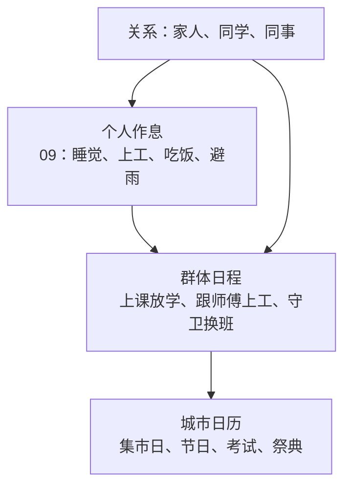

# 城市节奏：群体日程与城市日历

**案子身份：设计中案 · 2026-10-15。** 在[居民的一天](09_居民的一天与城市人气.md)的个人作息之上，让一群人按同一张日程行动，让全城按日历过节、赶集、考试，并让居民之间有家人、同学、同事的关系。总纲见[异世界冒险体验](../../../10_product/异世界冒险体验/README.md)。

## 一座城有自己的节奏

<small>原话：“如果想做到那种一天下来看到好多NPC去上学，放学了各回各家，有时候还有活动一起玩”</small>

**AI 总结：** 个人作息让每位居民各自生活，城市节奏让一群人同时做同一件事：钟声一响，学生从宿舍走向教学楼；放学后各自回家；守卫在城门换班；学徒跟着师傅一起上工。玩家看到的是成群的人流，而不是零散的个人。

## 群体日程

**AI 总结：** 城市配置时，AI 为每座城描述几个群体，例如学生、学徒、守卫、商队、农户，程序据此展开居民（沿用第四题实验中“AI 写群体，程序展开”的做法）。同一群体共用一张日程：何时集合、去哪里、做什么、何时解散。群体里的人出发略有先后，走自己的路，不排成队列；遇到雨天、节日或玩家打扰时按规则调整，结束后回到原日程。

## 城市日历

<small>原话：“对的对的！就是日历！我当时在玩星露谷的时候就注意到这个设定了”</small>

**AI 总结：** 每座城有一份日历，按游戏中的日子安排周期性的活动：集市日全城的人去广场赶集，节日有庆典与聚会，学院有入学、考试与毕业典礼，农庄有播种与收获节。日历在城市配置时由 AI 结合文明与城市设定选定，具体日子和流程由程序执行。玩家能提前知道近期有什么活动，可以参加，也可以错过；活动结束后，相关的事写进游记。

## 关系：家人、同学、同事

**AI 总结：** 居民之间有家人、同学、同事、邻居等关系。闲聊时优先找熟人，回家回的是自己的家庭，放学的同学一起走一段路，节日时家人聚在一起。关系在城市配置时按群体与住房批量生成，不逐人配置；玩家与其中一人交好，也会被他的家人和朋友认识。
