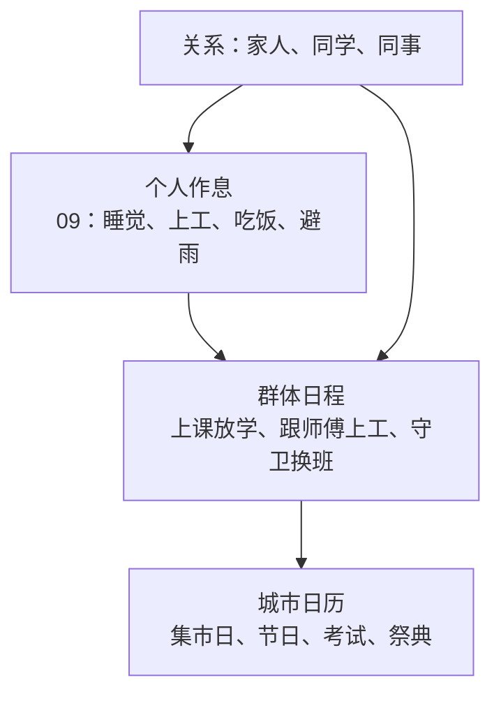

# 城市节奏：群体日程与城市日历

**案子身份：设计中案 · 2026-10-15。** 在[居民的一天](09_居民的一天与城市人气.md)的个人作息之上，让一群人按同一张日程行动，让全城按日历过节、赶集、考试，并让居民之间有家人、同学、同事的关系。总纲见[异世界冒险体验](../../../10_product/异世界冒险体验/README.md)。

## 一座城有自己的节奏

<small>原话：“如果想做到那种一天下来看到好多NPC去上学，放学了各回各家，有时候还有活动一起玩”</small>

**AI 总结：** 个人作息让每位居民各自生活，城市节奏让一群人同时做同一件事：钟声一响，学生从宿舍走向教学楼；放学后各自回家；守卫在城门换班；学徒跟着师傅一起上工。玩家看到的是成群的人流，而不是零散的个人。

## 群体日程

**AI 总结：** 城市配置时，AI 为每座城描述几个群体，例如学生、学徒、守卫、商队、农户，程序据此展开居民（沿用第四题实验中“AI 写群体，程序展开”的做法）。同一群体共用一张日程：何时集合、去哪里、做什么、何时解散。群体里的人出发略有先后，走自己的路，不排成队列；遇到雨天、节日或玩家打扰时按规则调整，结束后回到原日程。

## 城市日历

<small>原话：“对的对的！就是日历！我当时在玩星露谷的时候就注意到这个设定了”</small>

**AI 总结：** 每座城有一份日历，按游戏中的日子安排周期性的活动：集市日全城的人去广场赶集，节日有庆典与聚会，学院有入学、考试与毕业典礼，农庄有播种与收获节。日历在城市配置时由 AI 结合文明与城市设定选定，具体日子和流程由程序执行。玩家能提前知道近期有什么活动，可以参加，也可以错过；活动结束后，相关的事写进游记。

## 活动类型：作者配置，AI 选择，程序执行

个人生活动作、设施配置与开发扩展统一由 [09 内置生活行为与作者扩展](09_居民的一天与城市人气.md#内置生活行为与作者扩展)定义；本案的群体活动复用这些能力，并组织活动流程。

<small>原话：“话说目前咱的设计里日历也是LLM开局配的嘛，动态的节日确实会很有惊喜的，不过是不是也可以用类型（这样是不是可以更好处理居民的行为）？因为感觉全世界甚至各种游戏里的节日可能都是有限的？就是感觉可以走配置类型，这样后面比如整合包作者打算加mod，有其他的节日，也可以加行为”</small>

**AI 总结：** 日历上的活动与委托采用同样的分工：

- **作者与整合包提供活动类型。** 每种类型规定谁参加、需要什么场地、居民在活动中做什么（选用哪种玩法骨架，见下文）、玩家可以怎样参与、持续多久，以及结束后留下什么，例如关系变化、奖励或游记。
- **AI 在开局配置城市时选择类型。** 从已有类型中为每座城挑选适合其文明与职能的活动，起名字、定日子、写由来，并加入地方特色；同一类型在不同文明里可以完全是不同的样子，例如精灵与矮人各自的丰收节。
- **程序按类型执行。** 居民在活动中的行为由类型保证，可以测试、不会出错；AI 不为每个节日临时编写行为。

节日种类本身有限，常见的有集市日、丰收节、祭祀与祈福、比武大会、灯会与夜市、学院考试与典礼、纪念日、迎宾与庆功等；每个世界不同的是名字、由来与地方特色。

### 按行为分类：玩法骨架与活动内容

<small>原话：“感觉美食祭、啤酒节这种，是不是都算是聚会类的？我刚刚想到的是这种情况，比如加赛车mod、还有航空学之类的，是不是就可以出个竞速（但是这样一说又感觉可以分成一个竞速类？） 哦哦完好像有点懂了，具体是否分类，是看行为？比如竞速类不就是有一个地点到目的地，聚会就是大聚会并且会刷新吃吃喝喝的？”</small>

**AI 总结：** 活动分两层。两个活动是否属于同一类，看居民和玩家在活动里怎么动，不看主题：

- **玩法骨架**：规定居民和玩家怎么动，由程序实现，数量少、可测试。
- **活动类型**：选一种骨架，再填上内容，包括场地、物资、载具、参与条件、奖励与名称风格。

| 玩法骨架 | 居民和玩家怎么动 | 活动类型举例 |
| --- | --- | --- |
| 聚会 | 众人聚到一处，场内不断补上吃喝，有人表演，居民轮流来去 | 美食祭、啤酒节、丰收宴、庆功宴 |
| 集市 | 摊位排开，居民买卖，玩家可以采购或自己摆摊 | 集市日、夜市、交易会 |
| 竞速 | 从起点出发，经过途经点到达终点，按到达先后排名，观众沿途观看 | 赛马、赛艇、赛车（赛车 Mod）、飞行赛（航空 Mod） |
| 比试 | 参赛者轮流或两两比拼，由裁判判定，观众围场 | 比武大会、锻造大赛、厨艺比拼、学院考试 |
| 仪式 | 主持者在固定位置主持，众人按顺序行礼、观礼 | 祭祀、祈福、典礼、纪念日 |
| 巡游 | 队伍沿路线行进，沿街居民聚集观看 | 迎宾、游行、灯会 |

- **一个节日可以由几个环节组成，每个环节用一种骨架。** 例如丰收节可以是"仪式 → 集市 → 聚会"，海港城的节日可以在聚会之外加一场赛艇。
- **大多数 Mod 只需要提供内容。** 赛车 Mod 和航空 Mod 提供载具，套用"竞速"骨架就能出赛车和飞行赛；料理 Mod 提供菜品，套用"聚会"或"比试"骨架就能出美食祭和厨艺比拼。整合包作者通过配置完成这些，不需要写代码。
- **只有带来全新动法的 Mod 才需要新骨架**，例如 Mod 本身带来一种以前没有的集体玩法。新骨架由 Mod 开发者用代码扩展；加入后，所有活动类型都能使用它。

## 关系：家人、同学、同事

**AI 总结：** 居民之间有家人、同学、同事、邻居等关系。闲聊时优先找熟人，回家回的是自己的家庭，放学的同学一起走一段路，节日时家人聚在一起。关系在城市配置时按群体与住房批量生成，不逐人配置；玩家与其中一人交好，也会被他的家人和朋友认识。
