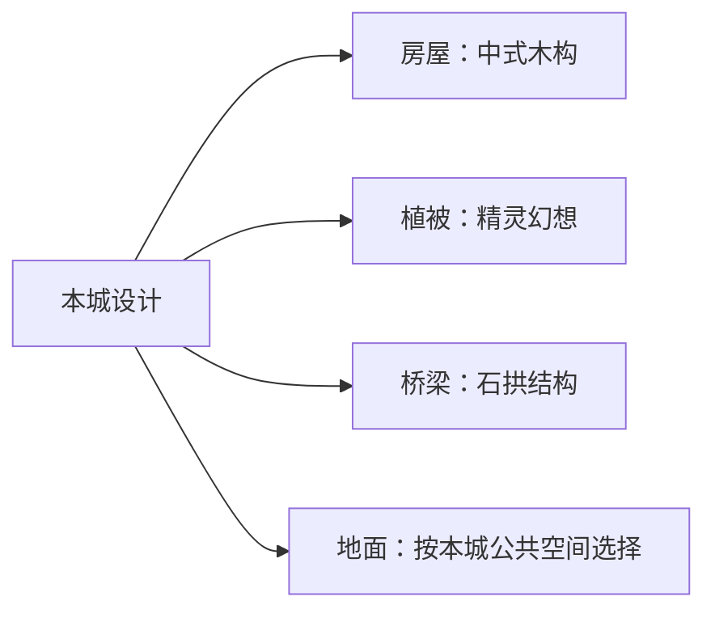

# 城市分项风格与换皮

**设计中案 · 2026-10-05**。[返回总览](../../../../../../../10_product/城市设计与完整落地/README.md)。本轮整理需求，尚未接管实现。

主责任是 D4 的全城设置，后续生成沿用设计选择。房屋、植被、地面和桥梁分别选表达，统一方案之下允许局部精修。

## 不同内容可以采用不同风格

<small>原话：“其实完全可以房子都是中式的，但是植被全部都是精灵的那种奇幻风树木或者草地设计”</small>

**AI 总结：** 建筑风格不包办全城。房屋、植被、地面和桥梁可分别选择素材方向，再组合成统一城市。公共区域和景观的选用、是否换皮在全城设置中交代，不要求逐栋重复填写。

例子说明可以混搭，不规定每座城市固定采用四项组合。

## 整体统一，局部只改一部分

<small>原话：“我原本设想的是换皮是有的可以统一风格换一次，同时各个结构也可以精修换一小部分”</small>

**AI 总结：** 先给所选范围一套统一材料方案，具体选结构时再调整少数部位。没有局部修改的部分继续继承整体方案；没有适用整体方案的部分使用素材原样。只改被标记可换的部位，不把屋顶换材连带施加到家具。

整体方案可以针对全城或所选风格分别设置；沿用全城默认、所属风格调整、单个结构精修的次序。结构未改的部位继续继承，不必反复填写整套方案。

## 材料变化与造型变化分开

<small>原话：“这些东西只需要换一下材质又能得到其他东西，因为我们配套的只是结构而已”</small>

**AI 总结：** 换皮复用已有形体；需要另一种桥型、树形或房屋组合时，另选结构或形体。可用部位及材料来自素材说明，未支持的效果要作为素材需求提出。

## 导出时自动找出可换的材料

<small>原话（2026-10-18）：“还有每次进入某个国度的时候，是不是我们就得配置一下换皮方块了呢，我此前一直希望的是studio里的建筑导出的时候，会有各种可换皮方块（比如墙体原本是某色的某方块），我们是不是可以用颜色筛选并标记出是哪个mod里的，也就是mc的记得原本就是有个tag的？然后在某个国度甚至某个城市的时候，再选择这套建筑的整体风格换皮，这样我感觉能至少让mod里的方块参与进来。”</small>

**AI 总结：** 2026-10-18 用户确认方向。由作者逐一标记可换部位负担太重，改为工作台导出时自动提出、作者确认：

- **按部位分组。** 导出时按方块与位置把模板分成墙体主色、墙体饰边、屋顶、地板、柱梁、窗等部位，作者确认或调整。门、床、工作方块等功能方块不参与材料换皮，工作方块另见 [08 Mod 工作方块](../../../../../../../addons/realmfolk/需求案/08_整合包Mod适配与拜师学艺.md#mod-工作方块功能位替换)。
- **换的是一整套材料，不是单个方块。** 同一种材质的完整块、楼梯、台阶、墙、栅栏、门要一起换，否则墙换成 Mod 木板、楼梯还是原版橡木，或者某个 Mod 没有对应形状，造型就会坏。程序先把已安装的方块整理成“材料套”（同一材质有哪些形状），换皮时整套替换，缺少所需形状的套不参与。
- **用标签、来源和颜色找候选。** Minecraft 的方块标签（如木板、原木、楼梯、墙）和 Forge 通用标签说明材料类别，方块 id 的前缀就是来源 Mod；颜色先用方块的地图颜色粗筛，需要更准时由工作台离线读取材质贴图算出平均色。这样已安装 Mod 的方块都能成为候选，而不只是原版。
- **候选不等于可用。** 找到的材料套标明来源与检查结果；实际放置出现问题时，记录具体材料、部位和现象，便于替换。

## 国度定基调，城市微调

<small>原话（2026-10-18）：“国度基调城市微调我感觉挺不错的，咱们来写案子呗。”</small>

**AI 总结：** 换皮在原有“整体统一、局部精修”的次序上加上国度一级：

1. **国度（文明）选整体风格**，例如精灵国用某个 Mod 的白木加苔石，矮人国用深板岩和铜。同一国的城市一眼能看出同属一个文明。
2. **城市在国度基调内微调**，例如同一国里港口城偏湿木与砖，山城偏石材。
3. **单栋建筑精修少数部位**；没有改的部位继续继承上一级。

## 道路、挡土墙、绿化归入同一套风格

<small>原话（2026-10-18）：“还有特定风格的道路、挡土墙、绿化的问题，目前是在什么时候配置呢”</small>

**AI 总结：** 现在地面、道路、挡土墙、护栏、桥的材料和绿化目录，都在 D4 全城构思时由 AI 按城市单独选，只有少量原版预设，和建筑风格互不相干。今后它们与建筑换皮一起归入国度风格：国度选风格时，建筑材料套、道路与地面、挡土墙与护栏、桥、绿化目录一次定下；城市只做微调；具体区或某类路仍可局部改。已有的“AI 在城市设计时选材料”（见 [AI 材质选择与景观参数](../CityAI材质选择与景观参数-v0.1/README.md)）保留为城市微调与局部修改这一层。
