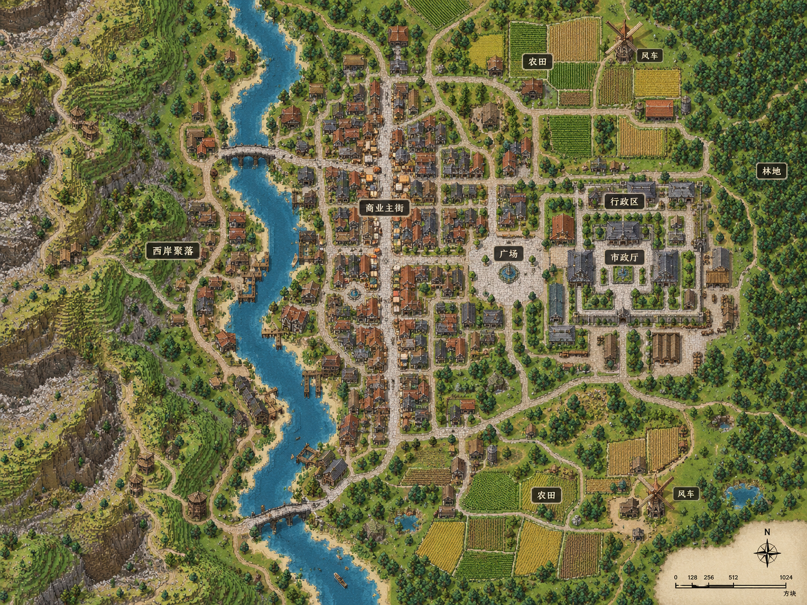

# 城市规模与空间组织

**能力参考（规模、嵌套与空间组织）。** 主责任为 D4；设计循环、选材角色和修订权限统一见[按功能区设计城市](../../30_D4蓝图编译/按功能区设计城市/README.md)。本页不规定阶段顺序。

## 规模由设计的阵列与嵌套表达

<small>原话：“首先我觉得硬面积是和适应地形、适应建筑冲突的，所以我考虑的方向才是要求阵列算法的使用程度来限制AI的落地结构数量”</small>

<small>原话：“大规模城市必须使用阵列嵌套，这点是应该明确写进限制阀门并告诉AI的。”</small>

<small>原话：“比如大都市，程序要求某个功能区2000平方米的面积，那么我们手头有几个建筑就拿这几个建筑的面积，让AI估计一下要多少个建筑，引导他根据这个数量来设计阵列和阵列嵌套”</small>

**AI 总结：** 城市规模通过有功能含义的建筑数量、阵列和嵌套表达；面积可辅助估算，不作补量硬指标。大规模城市使用嵌套形成组织，不靠随机外扩补房。具体数量随地形和所选素材设计。

## 完整阵列相邻，连接不补建筑

<small>原话：“因为就算是做连接，连接这个动作本身就是乱填建筑，本身就会冲淡结构的设计感”</small>

<small>原话：“我的想法是在一个阵列旁边再挤一个阵列。这两个阵列其实是有种两个正方形的关系的”</small>

**AI 总结：** 相邻落位按完整阵列占地考虑，保留内部布局；连接动作不额外填房。不规定所有阵列的原点，也不要求所有功能区紧贴。

```text
[已有阵列 A：内部布局保留]   间距   [完整阵列 B：按设计排布]
                 道路按实际通行需求连接
```

## 以预览判断城市整体性

<small>原话：“临近这个指标我觉得我们可以再精确点，没必要一定要相连这种，比如有时候可能隔着一条河这种，AI自己觉得有整体性了就行”</small>

<small>原话：“目前评判的提示词在哪呢，我觉得得加上必须以预览图为主，而不是照着数据想当然”</small>

**AI 总结：** 以实际预览中的布局、尺度、朝向和中间空间判断整体性，数据辅助核对；允许道路、广场、绿带或河流间隔，不要求接触、统一距离或填满空隙。外围独立区需要用途理由；总览标记和受控扩张为可选能力，其权限服从当前设计循环。

## 扩张保护功能，交通服务真实建筑

<small>原话：“挤占我觉得又不能给其他功能区给直接挤完”</small>

<small>原话：“我觉得应该是道路给建筑让步，因为他是后面来的”</small>

<small>原话：“嗯写进案子里吧，也就是阵列的时候就得给主路留空间”</small>

**AI 总结：** 修订或扩张不能使其他区失去功能主体；当前功能区循环冻结其他区布局。阵列预留通路和主路接入空间，后生成的道路不为路线搬走建筑，空间关系不自动生成道路或桥梁。道路、地形和基础执行分别遵循各自当前案。

## 沿岸组团与嵌套参考

<small>原话：“沿岸这种，这个方式的还是很合适的”</small>

**AI 总结：** 根据地形组织主街、街区、院落和沿岸组团；示意表达空间关系，不是每城必用的固定模板。



## 调用效率目标

<small>原话：“这个方案是不是一个大城市也就最多20次调用，我感觉还是很好的，一座大城市设计5分钟以内感觉”</small>

**AI 总结：** 约二十次调用、五分钟是效率目标，不是失败门槛，也不限制当前案允许的看图修订。输入错误和失败恢复见[提交纠错与失败恢复](../../30_D4蓝图编译/City提交纠错与失败恢复-v0.1/README.md)。

## 地形保护与自然空间

<small>原话：“反正核心目的就是要用台面来保护D4的设计不被奇奇怪怪的地形恶心”</small>

<small>原话：“如果遇到那种发现台面要建立起来需要超过一定高度的，那就建成类似桥一样的，比如设置最大高度是16，超过16就在底部生成个黑石栅栏表示像桥一样的设计吧。”</small>

**AI 总结：** 基础保护城市设计，可用架空表达消化大高差；原话中的高度和黑石栅栏是举例。具体取高由[主建筑与分层台地](../../60_LandUse与城市基面/主建筑与分层台地/README.md)维护，实际适配及完整性由[完整落地设计案](../../40_D5至D7边界与激活/城市设计完整落地/README.md)讨论，不将示例变成全城固定规则。

<small>原话：“我们直接在一个slope上用compact阵列，中间以各个为端点就能形成S型的主路”</small>

<small>后续澄清：“农村这个不是全是次级道路吗”</small>

**AI 总结：** 沿坡聚落可以组织错落建筑与次级通路；保留城市主路和农村次级通路的层级区别，不把自然地形统一做成大平面。
