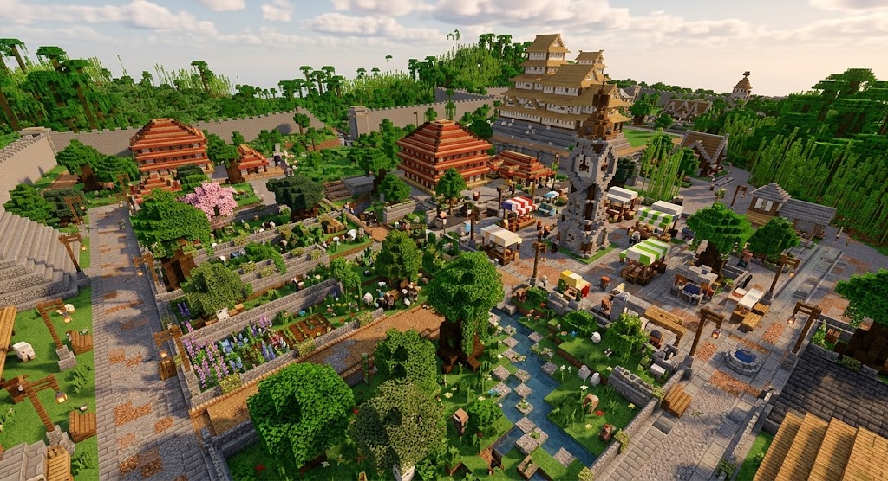
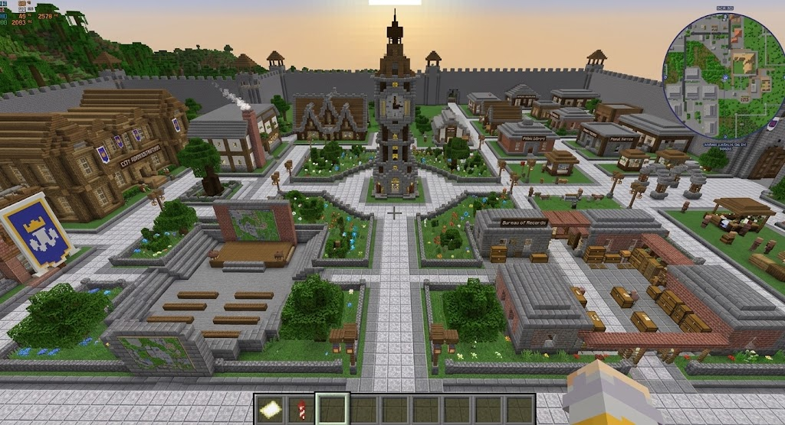

# 阵列组合审查

**能力参考（组合效果与预览审查）。** 属于[聚落空间与地表升级](README.md)。素材类别由[风格素材与配套](../../../../../../../tools/structure_studio/10_product/风格素材与配套.md)维护；本次核心、必需配套、填充和修订流程由[按功能区设计城市](../../30_D4蓝图编译/按功能区设计城市/README.md)维护。

## 核心与配套共同形成组合

<small>原话：“核心建筑必须使用阵列才能落地，这样的话就不会再出现这种大而空的情况了（在我们的填充和核心的标记得好的情况下）”</small>

**AI 总结：** 核心纳入阵列，与配套结构或子阵列一起形成有主次、大小搭配的功能区。核心不必最大，素材自带的院落、花坛和座椅计入效果，避免重复添加。本次角色由设计决定。

[现状：相似尺度建筑群](images/现状_建筑群.png)

## 只剩孤立核心时返工

<small>原话：“要不干脆先试试，看看到底会返工几次，我感觉返工率不一定高，先把这个需求也写进案子吧”</small>

**AI 总结：** 预览只剩孤立核心时调整选材或布局，不因核心落位就算完成。观察实际返工次数，再决定是否放宽；失败边界服从当前设计循环和恢复要求。

## 组合效果通过实际预览审查

<small>原话：“核心建筑必须使用阵列才能落地”</small>

**AI 总结：** 继续由 AI 结合地形组织结构与阵列，具体组合通过实际预览判断；不按集市、广场等名称增加专用生成系统。COMPACT 可使用小模板，具体间距、嵌套和随机组合不在本页预定。中心阵列改进由[阵列当前案](../../30_D4蓝图编译/City阵列主从骨架与街带-v0.2/README.md)维护，不在本页另立算法或流程。

以上图片仅作大小搭配、组合效果参考，不要求复刻。
