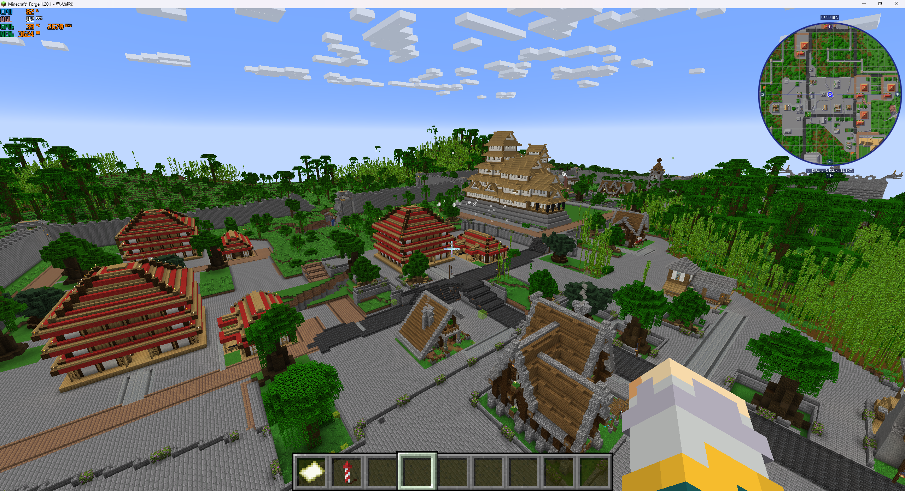

# 城区地表与公共绿化

**实现当前案（城区公共地表与绿化升级）。** 属于[聚落空间与地表升级](README.md)。2026-09-21 用户确认并授权完整开发。

## 需求原话

> 我们的城区里面会保留特别多的原始地表，就是台地周围的不知道是绿化带还是没形成台地的区域

> 应该改为我们生成的绿化带，我们可以用配置和预设让这些绿化带长得漂亮点，但是我感觉绝对不能用原始的群系植物来凑合

> 其他提到的村庄和原始地形暴露的问题我觉得还是得修的

## AI 需求总结

### 整理公共绿化候选素材

优先整理已有模板，复用现有结构落地能力，不因素材名字含“绿化”就直接纳入自动放置。

- **小型独立结构**：树木、花坛、树池等供程序在合适公共空地选用，按实际尺寸避让结构、入口和道路。
- **完整组合结构**：花园、喷泉庭院等保留自带装饰，由 AI 作为结构参与阵列设计，不自动塞入零碎间隙。
- **地表预设**：草地、花草、低矮灌木的搭配负责模板之间及不规则边缘，使用受控材料和密度。
- **素材判定**：核对实际占地、连带装饰、地基和高差要求，以及适合独立或成排使用的方式。道路树可共享适用素材。

### 处理城区间隙的原始地表

将城区内台地周围、结构群之间的间隙纳入公共地表处理，消除无意暴露的原始地面与群系植被。**没有台地也需要处理**，但不要求全部铺石地或抹平高差。

2026-10-18 用户确认第二轮高度组合方案：“可以的，这套就自然很多，我们改改呗”。共享台地内的普通草坪、铺装和步道沿用同一基面；外围绿地在接路、接广场处接平，再逐步顺坡回到自然地形，不以庭院矩形或地块切分边界产生突兀高坎。护栏与挡土边由最终真实高差决定，同台内部不生成假挡墙。

先确定完整地面关系，再布置植物。树根和素材落地面读取最终地面；抬高花坛的土层是素材自身构造，不改变整片城区标高。普通草地不能用桥或建筑基座的方式在深坑上封出一层悬空草皮；明确的桥继续按桥面和两岸关系处理。

[现状原图](images/现状_建筑与铺地.png)

### 使用受控公共绿化

用自己的配置与预设组织植物搭配、绿化边界及视觉效果，与通路、结构和台地衔接，**不用原始群系植物凑合**。建筑自带装饰继续随素材使用，不逐栋自动补一圈绿化；素材内的装饰不能替代结构之间的公共地面处理。具体预设待定。

参考：绿化有边界，通路有留白，不要求复刻固定形状。

[参考原图](images/参考_中心钟楼与公共花园.png)

### 拒绝不适合种植的位置

<small>2026-10-15 原话：“可以做类似台地的操作吗，就是该补洞就补洞？不过感觉那样好复杂，要不直接否定？”随后明确：“就是程序上不给这一块的植物下来”。</small>

**AI 总结：** 城区内部绿地和外围补植遇到洞口、水边、承载不足或空间占用时，拒绝该处的树木、花坛或花草，不为补植额外填洞、造台地或自动换位。按完整景观素材判定，避免留下半棵树、半个花坛；原有建筑、道路和台地继续按其规划施工。

### 绿地顺应大地形，去掉碎台阶；绿化要有构图

<small>2026-10-17 学院试玩原话：“感觉很简陋，而且花坛也长得怪怪的(虽然感觉是素材上的问题)”；“提出疑问：是否应该保留绿化区域的原始地形……这个审美方面的，我也不太拿得准”</small>

**AI 总结：** 学院城的绿地完全按原地形铺草，约 11% 的绿地处在高差边上，草坪上布满一格高的土边，有的坎两格以上，人走不上去。花坛全是同一个白色石英花槽，在草坪上随机撒了 320 个，灌木、绿篱和花丛反而一个都没种上。

- **地形：顺应大坡向，去掉碎台阶。** 不整平整片绿地，但把一两格的小起伏归并成少数几个平台，单格的坑和凸起直接填平或削平；留下的高差用矮边、台阶或缓坡刻意收边。内院、广场这类有设计的公共空间整平；外缘绿地和林缘保留原地形。
- **构图：先有结构，再撒底色。** 内院和广场按公共空间构图布置（中心焦点、环形或对称种植、沿路行道树）；随机散点只用来铺边角。花坛只作为入口和路边的点缀，不在草坪上到处撒。
- **层次：乔木、灌木、绿篱、花都要有。** 每一类都要有自己的数量上限，不能让一类把名额全部占光。
- **素材：补花坛变体。** 补充低矮、木质或石砖、种植面更宽、不带紫水晶的花坛，以及绿篱段、花境带这类成组素材。这一项需要作者在工作台补素材。
