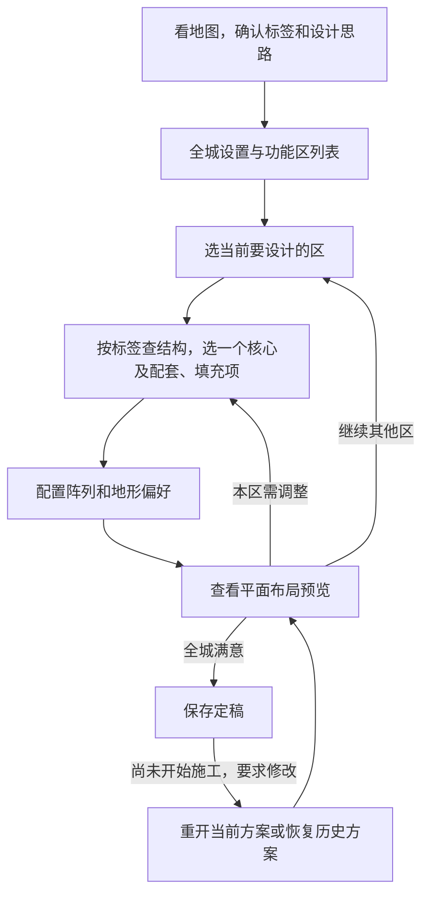

# 按功能区设计城市

**实现当前案 · 2026-10-07 接管 D4 功能区设计循环**。[返回总览](../../../../../../../10_product/城市设计与完整落地/README.md)。本批按用户授权接管选材、阵列编译、预览与逐区修订。

主责任是 D4。用简短的全城方向带动逐区选材和阵列设计，以实际预览判断是否形成整体。

**当前状态：部分实现；2026-10-21 用户认可手册修订版的 D4 设计效果。** 用户确认该版本已恢复到以前的质量。程序侧剩余四项整改和改动后的复验见[路线图](../../../../../../../00_nav/路线图.md#d4-失败验收整改--2026-10-20)。

## 先定方向，再列功能区

<small>原话：“决定锁定本次的结构选择决策和城市设计思路（比如建筑使用中式、植被选用精灵、地面桥梁使用xxxx，设计思路则是可以一句话带过）”</small>

**AI 总结：** 承接第二题，看局部地图后确定本城的选材标签与一句设计思路。配置公共区域、景观、整体换皮，再列功能区及主次。此时确定的是选材方向，不必提前挑完所有结构。

## 从主到次，边查素材边设计

<small>原话：“开始从主到次阵列，每次阵列的时候都会去根据我们锚定的tag去搜结构，看看有没有合适的”</small>

**AI 总结：** 每设计一个区，就结合它的功能和已选风格查询合适结构，再决定阵列方式、需要的组合和地形偏好。按当前任务提供候选和预览，缺合适素材就说明缺项，不为凑齐数量反复摆同一栋建筑。

## 每个功能区一个核心，同类区可以相邻组合

<small>原话：“我觉得只有一个核心是不是方便点，你觉得呢，我们只需要把多个同类功能区连起来就能得到一片很大的功能区了。并且这片地方还很有层次”</small>

**AI 总结：** 每个实际参与阵列的功能区只设**一个核心**，围绕它组织主要位置、朝向和配套。多个同类区相邻，形成更大的功能片区；不把这片区域再次合成一个巨型阵列或另设共同核心。同类区可选不同核心模型，避免重复整套组合。

## 必需与填充属于本次功能区

<small>原话：“哪些结构打算必须落地，哪些是用来填充充数的（阵列里的修饰项），甚至可以配一下地形偏好等等”</small>

**AI 总结：** AI 明确本区哪些内容必须保留，哪些用于配套、填充或修饰。素材的特色／通用不替代这个决定。唯一核心不等于其他建筑都可删除；承担必要功能的配套也要保留，不能只剩装饰却声称功能成立。具体适配见 [完整落地](../../40_D5至D7边界与激活/城市设计完整落地/README.md)。

## 按功能区核对人口与容量

<small>原话（2026-10-17）：“嗯，你提到的先确定职责再规划人口我感觉蛮好的，而且是不是可以一个一个功能区来？这样可以让LLM设计的时候更精细而且也更科学”</small>

**AI 总结：** 设计顺序以 2026-10-20 的[城市要展开，不要收缩](#城市要展开不要收缩)为准：先展开工作职责与空间，再让公共、居住随之做大，人口后置核对。人数是范围和估算，不是起点或上限；不先锁定一个人数再限制楼数，也不为对齐数字压缩城市。生活设施清单中的实际床位、工位和公共容量用于检查方案是否可信，住处与工作地之间的通勤也要合理。

全城复核时把各区相加，核对总人口、总床位、总岗位与公共容量。各区的人员构成随城市设计保存，交给 Realmfolk 的[快速配置](../../../../../../../addons/realmfolk/需求案/07_城市内容快速配置.md)，快速配置只需起名字、写性格，不再重新猜人数与岗位。实际人口仍以落地后真实可用的床位为准，与设计的差距如实报告。

## 功能区分三大类：工作定岗位，居住和公共由此推算

<small>原话（2026-10-18）：“从这里在思考功能区的概念，我认为功能区是不是有大类的？比如工作的、比如公共的、还有居住的，公共的大伙可以排队去熙熙攘攘，居住的夜晚或者NPC累了会回去，工作的则是是不是得一开始就定下来？根据这个数量再决定居住区需要多少人 这样我感觉才能实现各个时段每个区域都是熙熙攘攘的？”</small>

**AI 总结：** 2026-10-18 新增，待开发。功能区按人在一天中去哪里分成三大类，每类在不同时段热闹：

| 大类 | 什么时候人多 | 规模怎么定 |
| --- | --- | --- |
| 工作 | 白天 | 先展开城市职责与工作空间，再核对岗位需求 |
| 居住 | 夜里、累了 | 随工作职责和城市规模展开，再核对常住人口所需床位，含不上班的人 |
| 公共 | 饭点、傍晚、节日 | 随各区活动和城市规模展开，再核对食堂座位、广场等公共容量 |

- **人口 = 岗位人数 + 不上班的人。** 学生、孩子、老人不占岗位，但占床位和公共空间。工作区既写岗位，也写服务对象，例如教学区分别考虑教师岗位和学生座位，学生同样计入居住；这些数量根据本城设计估算，不套用示例人数。
- **有些建筑同时属于两类。** 商店、食堂对店员是工作区，对顾客是公共区，两边都要计入。
- **公共区放在通勤路上。** 宿舍到工作区之间经过广场、食堂和集市，居民每天往返时自然从这里穿过。热闹来自路线，不只来自人数。
- **设计顺序：** 先展开工作职责、服务对象与各子区空间，公共与居住随之展开，公共区结合通勤路线安排。人口在后续复核中检查容量是否可信，并按时段看白天工作区、饭点和傍晚公共区、夜里居住区是否能形成城市生活。

### 功能区类型

作者与整合包提供功能区类型，例如教学区、居住街坊、集市、作坊区、码头。每种类型写明属于哪个大类、常见建筑、每人大致需要多少岗位、床位或公共空间。AI 挑选类型、定规模、起名字，并结合本城地形安排位置，不必每次从零推导。做法与委托类型、节日的活动类型一致：作者给类型，AI 选择并本地化，程序执行。

## 城市要展开，不要收缩

<small>2026-10-20 失败验收原话：“现在城市D4严重不合格……1、功能完全不会分，现在基本全是大功能，比如教学区+生活区+种植区，结果就是每个区域就寥寥几个建筑，手册里的‘子功能区’的没有一个agent注意到，更不会根据整个城市的效果预览图或者规模又或者覆盖面积去规划，每次的结果都是小小几个建筑。理想上一个比较大的功能区，比如教学区，里面有xx学部、教学楼群、行政楼、阅读自习区等等这种，随便就能分出很多子类来的。”</small>

<small>“2、会在人数上面纠结特别久，完全不知道居住人口是可以往大了做的，完全可以设计完工作相关的以后，公共也做大点，居住更是做大一点，现在会在这里纠结花很多时间。更严重的是，Astra居然照抄了手册里的60人。”</small>

<small>“3、完全不会利用空间，甚至最后不会检查是否已经设计够空间了。现在基本上就是很保守，只要不报错，不超出范围就过关，这是完全不对的。我不认为应该由程序检查建筑覆盖率，这样又会变成另一种极端，变成填鸭式设计。”</small>

**AI 总结：** 2026-10-20 失败验收暴露出以下问题；手册与阶段提示已按本节原则修订，修订版设计效果于 2026-10-21 获用户认可，程序侧四项整改仍待完成。原失败样本中，两个模型、三轮设计只交出 19～28 栋建筑，集中在岛的中南部；北部和东北的大片平地、林地没有设计论证。总设计核查发现，当时 AI 收到的几乎全是收缩方向的信号，没有一处要求它把功能展开、把场地用起来：

- 城市种子写“紧凑学院城”“保留林地”“按真实可建面积取舍”；
- 全国唯一的首都学院城在国度阶段被定为小镇规模，D4 拿到“初版 4～7 个阵列”的建议，Astra 正好交出 4 个区；
- D4 手册（2026-10-12 构图、10-18 按人定区两次修订，均由总设计编写）强调“紧凑优先”“全城一个或极少数根组合”“空地不是扩展理由”，并给出 60 名学生、93 人的示范数字，结果被直接当成规模；
- 程序给的人口指南要求“先写每区人口，再选楼”。

今后按以下原则设计：

1. **整体不等于小。** 整体指城市连续、骨架清楚，没有远离骨架、只靠长路挂着的孤立组团；它不限制城市的大小。城市规模由职责与地位（首都、全国唯一）以及场地决定，国度阶段的物理规模档位不能压住这一点。
2. **功能要展开成层级：大片区 → 子区 → 建筑组或院落 → 建筑。** 例如教学片区可以展开为若干学部、公共教学楼群、院务、阅读自习与研究实践等子区，每个子区有自己的活动、服务对象与空间组织；同类子区相邻，共同形成大片区。D4 全城构思时列出的功能区就是这些子区，不是“教学、生活、种植”这种大标签。是否拆分由本城职责与场地决定：不要一用途一栋楼，也不要给每个用途词都单独开区。
3. **人口跟着空间走，宁大勿小。** 先把工作职责展开，再让公共与居住随之做大；人数是范围和估算，用来核对床位、岗位与公共容量是否可信，不是上限，也不能为了对上数字去压缩城市。手册中的示例数字只说明算法，不给出具体规模。
4. **每片主要用地都要有去向。** 全城构思时按 D3 列出主要用地（例如北部平地、东北林地、南岸），说明各自承担什么，或为什么保留；保留的理由要具体（例如这片林地是观测区与生活区之间的静区、这片坡地坡度过大），不能用一句“保留林地”概括。
5. **停止依据看城市是否成立，不看是否报错。** 定稿时说明：功能是否已展开为可识别的子区；工作、公共、居住是否足以形成城市生活；每片主要用地是否都有去向；全城是否连续、有层次。“不报错、不出界、全部保留”只说明程序可行。
6. **不设硬门槛。** 不设建筑覆盖率、最低建筑数、最低子区数，也不要求填满空地；以上原则由 AI 在看图时判断，由用户或独立审查者验收。

失败验收报告与证据见实现仓 `dev_docs/systems/city/archive/7d023b29_v0.2.0_D4城市设计不合格验收/交接包/验收报告.md`。

## 看图修订，形成整体再提交

<small>原话：“然后就走D4的循环流程，也就是直到AI觉得预览图构成一个整体了，提交。”</small>

**AI 总结：** 提交阵列配置、看实际预览、调整并再次查看。D4 主要看平面构图，既看当前区域，也看各区与公共空间的整体关系。地图上的水域、高度和地形偏好仍供判断；少量水域或普通高差不直接否决布局，城市边界与建筑重叠仍须检查。具体高度、支撑和跨水衔接交给实际生成。实验调用实现中的同一套阵列能力，在设计过程中检验算法；不能用另一套排布生成示意图冒充结果。

本案已接管 D4 设计循环；每区初版完成后仍可看图重新选材与修订，其他已确认区保留。

## 定稿后可重开，历史方案可恢复

<small>原话：“就是是否也回退或者重修提交的方案的能力呢”</small>

**AI 总结：** 成功的设计保留可识别版本。城市定稿后、尚未开始施工流程时，可以重新打开当前方案继续修改，也可以选择同一批地形和素材资料下的历史方案恢复。重开与恢复都重新生成正式预览，之后仍须看图、修订和再次定稿；历史记录不直接变成已施工城市，失败次数不因恢复而清零。只想先存下方案继续讨论时，保存定稿后暂不启动施工。

已经开始后半段编译／施工流程或激活城市世界状态时，本批不允许设计回退；成功生成后的整城撤销另案处理。旧版地形或素材资料不混入本轮方案。

## 当前验收结论

<small>2026-10-21 原话：“这个手册改完后的那一版恢复回以前的质量了，这块我觉得还是很好的。”</small>

**AI 总结：** 用户认可手册修订后的 D4 设计效果，确认已恢复到以前的质量；不再把该手册版列为尚未获得效果认可。城市地位与规模、城市种子措辞、总览增补子区、公共空间坐标误拒绝四项程序整改仍待开发，完成后需再复验。2026-10-20 的失败样本与原因核查保留于实现仓 [D4 不合格验收交接](https://github.com/RinsingEL/StructureBinder/blob/1af9722b/dev_docs/systems/city/archive/7d023b29_v0.2.0_D4城市设计不合格验收/交接包/README.md)，描述当时版本，不覆盖本次认可。
