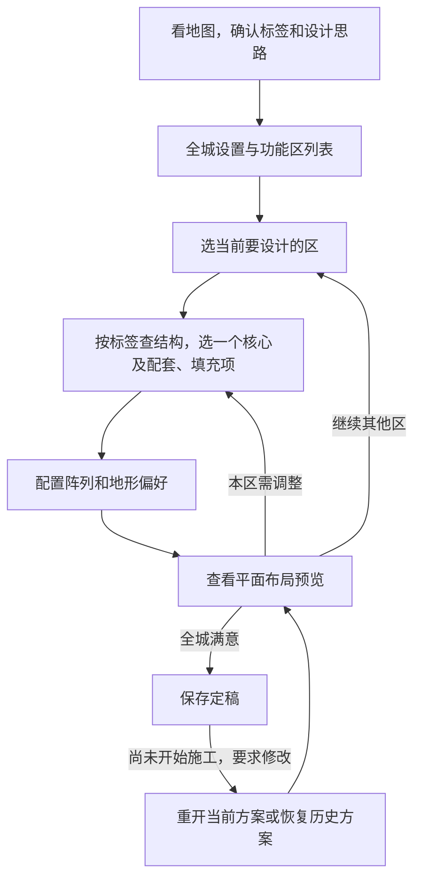

# 按功能区设计城市

**实现当前案 · 2026-10-07 接管 D4 功能区设计循环**。[返回总览](../../../../../../../10_product/城市设计与完整落地/README.md)。本批按用户授权接管选材、阵列编译、预览与逐区修订。

主责任是 D4。用简短的全城方向带动逐区选材和阵列设计，以实际预览判断是否形成整体。

**当前状态：部分实现；2026-10-20 用户验收未通过。** 最新要求已合入下文的功能细分、人口与规模、全城复核；设计效果仍需整改与复验，见文末验收结论。

## 先定方向，再列功能区

<small>原话：“决定锁定本次的结构选择决策和城市设计思路（比如建筑使用中式、植被选用精灵、地面桥梁使用xxxx，设计思路则是可以一句话带过）”</small>

**AI 总结：** 承接第二题，看局部地图后确定本城的选材标签与一句设计思路。配置公共区域、景观、整体换皮，再列功能区及主次。此时确定的是选材方向，不必提前挑完所有结构。

## 从主到次，边查素材边设计

<small>原话：“开始从主到次阵列，每次阵列的时候都会去根据我们锚定的tag去搜结构，看看有没有合适的”</small>

**AI 总结：** 每设计一个区，就结合它的功能和已选风格查询合适结构，再决定阵列方式、需要的组合和地形偏好。按当前任务提供候选和预览，缺合适素材就说明缺项，不为凑齐数量反复摆同一栋建筑。

## 大功能片区细分职责，每个实际阵列区一个核心

<small>原话：“我觉得只有一个核心是不是方便点，你觉得呢，我们只需要把多个同类功能区连起来就能得到一片很大的功能区了。并且这片地方还很有层次”</small>

<small>2026-10-20 原话：“理想上一个比较大的功能区，比如教学区，里面有xx学部、教学楼群、行政楼、阅读自习区等等这种，随便就能分出很多子类来的。”</small>

**AI 总结：** 教学区、生活区、种植区这类大功能片区不能只按一个笼统用途摆少量建筑；应结合本城职责、规模和场地，细分实际活动与子功能，例如各学部、教学楼群、行政和阅读自习。每个实际参与阵列的子区只设**一个核心**，围绕它组织主要位置、朝向和配套。多个子区相邻组成大功能片区，不把整片再次合成一个巨型阵列或另设共同核心。同类子区可选不同核心与配套模型，保持整体关系并避免重复整套组合。

## 必需与填充属于本次功能区

<small>原话：“哪些结构打算必须落地，哪些是用来填充充数的（阵列里的修饰项），甚至可以配一下地形偏好等等”</small>

**AI 总结：** AI 明确本区哪些内容必须保留，哪些用于配套、填充或修饰。素材的特色／通用不替代这个决定。唯一核心不等于其他建筑都可删除；承担必要功能的配套也要保留，不能只剩装饰却声称功能成立。具体适配见 [完整落地](../../40_D5至D7边界与激活/城市设计完整落地/README.md)。

## 按功能区定人口：先定职责，再定人，再定楼

<small>原话（2026-10-17）：“嗯，你提到的先确定职责再规划人口我感觉蛮好的，而且是不是可以一个一个功能区来？这样可以让LLM设计的时候更精细而且也更科学”</small>

<small>2026-10-20 原话：“完全不知道居住人口是可以往大了做的，完全可以设计完工作相关的以后，公共也做大点，居住更是做大一点，现在会在这里纠结花很多时间。更严重的是，Astra居然照抄了手册里的60人。”</small>

**AI 总结：** 逐区根据职责和活动确定需要哪些人，再安排建筑与容量。工作相关设计展开后，公共空间、居住容量和计划人口可以随城市规模扩大；人口推算用于校验基本需求，不把示例人数当成默认值或上限，也不在方案尚未展开时反复微调人数。逐区按这个顺序设计：

1. **这个区承担什么职责、发生什么活动。** 例如教学区负责上课、集会、办学籍。
2. **需要哪些人、各多少。** 例如分别考虑教师、院务和上课时段进出的学生，数量由本城职责、规模与活动安排决定。
3. **据此决定盖什么楼、盖几栋。** 生活设施清单里有每个模板的床位数和工位数，AI 对着它挑选建筑和数量，例如“这栋教所有 4 个工位，需要 2 栋”。
4. **住的人放在哪。** 住处靠近工作地，例如教师宿舍靠近教学区、餐食商住在食堂附近。

全城复核时把各区相加，核对总人口、总床位、总岗位和公共容量能否支撑设计，通勤是否合理。楼的数量随功能与规模确定，既不因示例人数把城市缩成几栋楼，也不为填满空地机械加楼。各区的人员构成随城市设计保存，交给 Realmfolk 的[快速配置](../../../../../../../addons/realmfolk/需求案/07_城市内容快速配置.md)，快速配置只需起名字、写性格，不再重新猜人数与岗位。实际人口仍以落地后真实可用的床位为准，与设计的差距如实报告。

## 功能区分三大类：工作定岗位，居住和公共由此推算

<small>原话（2026-10-18）：“从这里在思考功能区的概念，我认为功能区是不是有大类的？比如工作的、比如公共的、还有居住的，公共的大伙可以排队去熙熙攘攘，居住的夜晚或者NPC累了会回去，工作的则是是不是得一开始就定下来？根据这个数量再决定居住区需要多少人 这样我感觉才能实现各个时段每个区域都是熙熙攘攘的？”</small>

**AI 总结：** 2026-10-18 新增，待开发。功能区按人在一天中去哪里分成三大类，每类在不同时段热闹：

| 大类 | 什么时候人多 | 规模怎么定 |
| --- | --- | --- |
| 工作 | 白天 | 由城市职责决定要多少岗位，最先定 |
| 居住 | 夜里、累了 | 由工作人数倒推，再加上不上班的人 |
| 公共 | 饭点、傍晚、节日 | 由全城人口推算，例如食堂座位、广场容量 |

- **人口 = 岗位人数 + 不上班的人。** 学生、孩子、老人不占岗位，但占床位和公共空间。工作区既写岗位，也写服务对象，例如教学区既写“8 名教师”，也写“60 个学生座位”，学生同样计入居住。
- **有些建筑同时属于两类。** 商店、食堂对店员是工作区，对顾客是公共区，两边都要计入。
- **公共区放在通勤路上。** 宿舍到工作区之间经过广场、食堂和集市，居民每天往返时自然从这里穿过。热闹来自路线，不只来自人数。
- **设计顺序：** 全城构思时列出功能区并标明大类，工作区写清岗位和服务对象；据此算出居住区和公共区各需多大；逐区设计时先落实工作区，再做居住区，最后把公共区放在两者之间的路线上。全城复核按各时段检查：白天工作区、饭点和傍晚公共区、夜里居住区，是否都有足够的人。

### 功能区类型

作者与整合包提供功能区类型，例如教学区、居住街坊、集市、作坊区、码头。每种类型写明属于哪个大类、常见建筑、每人大致需要多少岗位、床位或公共空间。AI 挑选类型、定规模、起名字，并结合本城地形安排位置，不必每次从零推导。做法与委托类型、节日的活动类型一致：作者给类型，AI 选择并本地化，程序执行。

## 看图修订，形成整体再提交

<small>原话：“然后就走D4的循环流程，也就是直到AI觉得预览图构成一个整体了，提交。”</small>

<small>2026-10-20 原话：“完全不会利用空间，甚至最后不会检查是否已经设计够空间了。现在基本上就是很保守，只要不报错，不超出范围就过关，这是完全不对的。我不认为应该由程序检查建筑覆盖率，这样又会变成另一种极端，变成填鸭式设计。”</small>

**AI 总结：** 提交阵列配置、看实际预览、调整并再次查看。D4 主要看平面构图，既看当前区域，也看各区与公共空间的整体关系。提交前必须结合全城预览、城市规模与可用场地，复核功能是否细分充分、各片区与公共空间的体量是否合适、场地是否得到合理利用；留白和自然空间也应符合设计意图。没有报错、没有越界只说明通过技术检查，不代表设计完成。不以程序建筑覆盖率作为通过线，不为填满场地机械增加建筑。

地图上的水域、高度和地形偏好仍供判断；少量水域或普通高差不直接否决布局，城市边界与建筑重叠仍须检查。具体高度、支撑和跨水衔接交给实际生成。实验调用实现中的同一套阵列能力，在设计过程中检验算法；不能用另一套排布生成示意图冒充结果。

本案已接管 D4 设计循环；每区初版完成后仍可看图重新选材与修订，其他已确认区保留。

## 定稿后可重开，历史方案可恢复

<small>原话：“就是是否也回退或者重修提交的方案的能力呢”</small>

**AI 总结：** 成功的设计保留可识别版本。城市定稿后、尚未开始施工流程时，可以重新打开当前方案继续修改，也可以选择同一批地形和素材资料下的历史方案恢复。重开与恢复都重新生成正式预览，之后仍须看图、修订和再次定稿；历史记录不直接变成已施工城市，失败次数不因恢复而清零。只想先存下方案继续讨论时，保存定稿后暂不启动施工。

已经开始后半段编译／施工流程或激活城市世界状态时，本批不允许设计回退；成功生成后的整城撤销另案处理。旧版地形或素材资料不混入本轮方案。

## 当前验收结论

<small>2026-10-20 原话：“然后帮我写一份报告吧，验收报告，现在城市D4严重不合格。”</small>

**AI 总结：** 当前 D4 设计效果未通过用户验收。整改依据为上文的功能细分、人口与规模、全场地复核要求；2026-10-13 对当时效果的认可不代表本轮通过。最新原话、样本与提示词证据见实现仓 [D4 不合格验收交接](https://github.com/RinsingEL/StructureBinder/blob/1af9722b/dev_docs/systems/city/archive/7d023b29_v0.2.0_D4城市设计不合格验收/交接包/README.md)。本次只同步需求与状态，尚未完成整改或新的游戏验收。
