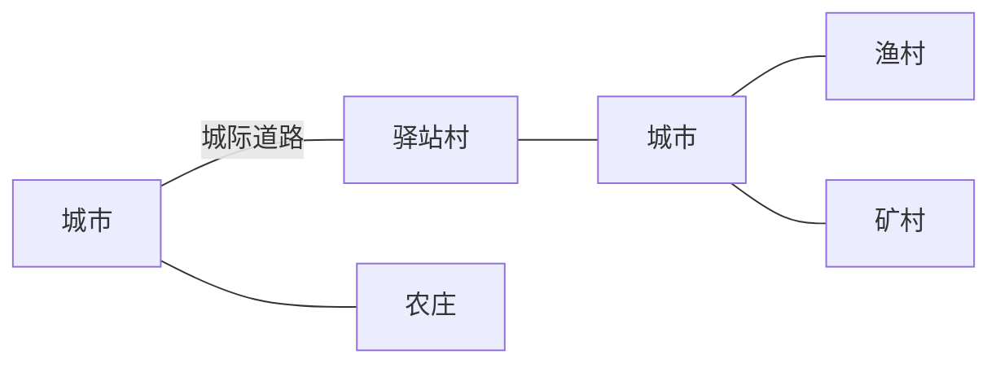

# 国度内部联系与小村庄

**设计中案 · 2026-10-14**。让一个国度在地图上连成一片：城市之间有看得见的道路，道路沿线和国土里散布着小村庄。往来的商队与传闻见 [Realmfolk 10](../../../../../addons/realmfolk/需求案/10_城际商队与传闻网络.md)。总纲见[异世界冒险体验](../../../../../10_product/异世界冒险体验/README.md)。

## 城市之间要有路

<small>原话：“而且现在其实城市与城市直接都没啥联系，既没有道路又没有商人”</small>

**AI 总结：** 同一国度的城市之间已有城际道路的设计（同国城市按位置连成路网，见 City 城际道路契约），但用户在游戏中没有看到城市之间的路。本案要求：玩家能在世界里实际看到并走上连接城市的道路，从一座城沿路走到另一座城；跨不过的海和大河，道路在岸边结束，并留出渡口的位置。道路是商队、旅人和村庄的骨架。

## 国度境内的小村庄

<small>原话：“更不用说我之前的设想是国度境内能程序化生成小村庄的”</small>

**AI 总结：** 国度境内由程序生成小村庄，让城与城之间不再是无人的荒野：

- **村庄有用途**：驿站村在道路中途供旅人歇脚，农庄在平原上种地放牧，渔村在岸边，矿村和伐木村靠近资源。
- **位置有依据**：沿城际道路、靠近适合其用途的地形，避开城市和危险地带；村庄数量随国土大小和道路长度变化。
- **风格属于国度**：使用本国文明的建筑素材，与城市风格一致但更朴素，规模只有几栋到十几栋。
- **配置要快**：每个国度由 AI 选择几种村庄类型及其特色，具体布局与人口由程序生成，不对每个村子单独做城市设计。
- **有人居住**：村民、村长、驿站老板等由居民系统安排，村庄也能接委托、做买卖、传消息。
